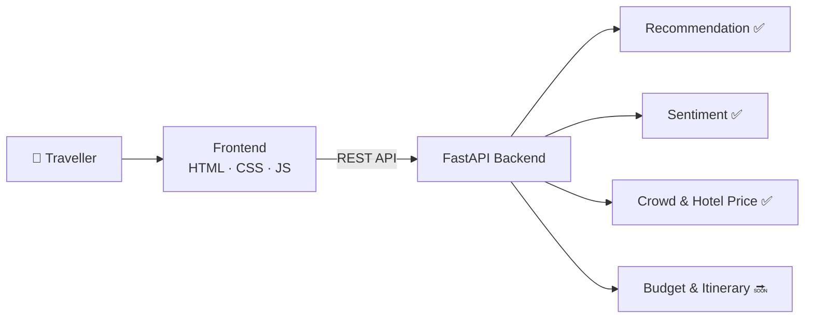
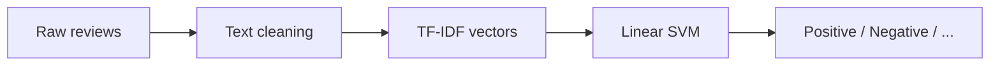

<div align="center">


<a href="https://github.com/SyrnaxX/WanderWise-AI">
  
</a>

<br/>


</div>


## 🧭 About

**WanderWise AI** is an AI-powered smart tourism system for personalized destination recommendations, travel planning, tourist analytics and intelligent itinerary generation.

**Initial focus:** India, starting with **Uttarakhand** — built so other states can be added later.


## ✨ What WanderWise Will Do

| 🏔️ Discover | 💬 Understand | 📈 Predict |
|---|---|---|
| Personalized destination recommendations | Sentiment analysis of tourist reviews | Crowd levels & hotel price estimates |

| 💰 Budget | 🗓️ Plan |
|---|---|
| Approximate trip cost breakdown | Optimized day-wise itineraries |


## 🚀 Modules & Progress

| # | Module | Techniques | Status |
|---|--------|------------|--------|
| 1 | **Destination Recommendation** | TF-IDF, Cosine Similarity | ✅ **Completed** |
| 2 | **Tourist Sentiment Analysis** | TF-IDF, Linear SVM | ✅ **Completed** |
| 3 | **Tourist Crowd Prediction** | Random Forest, XGBoost | ✅ **Completed** |
| 4 | **Hotel Price Estimation** | Regression, XGBoost | ✅ **Completed** |
| 5 | Travel Budget Estimation | Rule-based + ML | 🔜 Planned |
| 6 | Itinerary Generation | Haversine, Clustering, Greedy | 🔜 Planned |


## 🏗️ Architecture (Planned)



## 💬 Sentiment Analysis (Completed)



- **Model files:** [`models/Sentiment-Analysis`](models/Sentiment-Analysis)
- **Notebooks:** [`Notebooks`](Notebooks)
- **Results:** _add real test-set Accuracy / Precision / Recall / F1 here from your notebook._


## 🛠️ Tech Stack

**ML:** Python · Pandas · NumPy · Scikit-learn · XGBoost · NLTK  
**Backend (planned):** FastAPI · Pydantic · Docker  
**Frontend (planned):** HTML · CSS · JavaScript  
**Tools:** Kaggle Notebooks · Google Colab · Git & GitHub  
**Deployment (planned):** Vercel · Render

## 🗂️ Repository Structure

```
WanderWise-AI/
├── Notebooks/                 # Kaggle/Colab notebooks
├── models/
│   └── Sentiment-Analysis/    # Trained sentiment model files
├── docs/                      # README banner & assets
├── requirements.txt
├── .gitignore
└── README.md
```

## ⚙️ Getting Started

```bash
git clone https://github.com/SyrnaxX/WanderWise-AI.git
cd WanderWise-AI
pip install -r requirements.txt
```

## 🗺️ Roadmap

- [x] Repository setup
- [x] Destination recommendation
- [x] Sentiment analysis model
- [x] Crowd prediction
- [x] Hotel price estimation
- [ ] Budget estimation
- [ ] Itinerary generation
- [ ] FastAPI backend
- [ ] Frontend website
- [ ] Deployment (Vercel + Render)


<div align="center">

**SyrnaxX** · B.Sc. Computer Science, University of Delhi  
[GitHub @SyrnaxX](https://github.com/SyrnaxX)

⭐ *If you like this project, consider giving it a star.*

</div>
